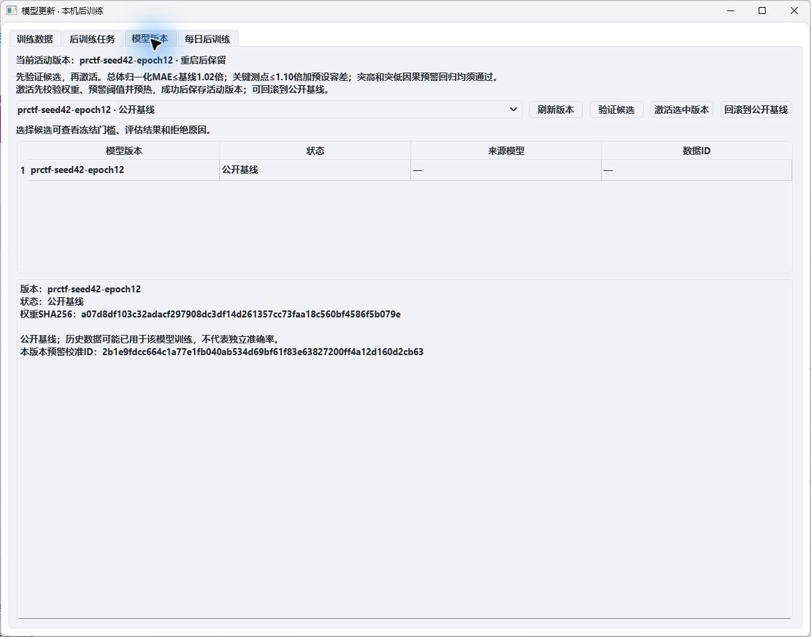

# Electrolyzer AI Monitoring System

[简体中文](README.md) · **English** · [Forecasting model: PhysicsRelationCTF](https://github.com/field-mx/PhysicsRelationCTF)

A **PyQt6 + FastAPI + PRCTF** Windows desktop application for electrolyzer monitoring, real forecasting, residual alerts, and model updates through Excel replay. Inference, training, and daily tasks run locally on CPU; no school server is required. The desktop interface is currently in Chinese.



*The actual model-management interface, showing only the public baseline and available controls. Industrial measurements and private candidate evaluation results are not displayed.*

## Features

| Area | Capabilities |
|---|---|
| Excel replay | The reference workbook has 61 channels sampled every second. Play, pause, reset, and change speed. |
| Real forecasting | Use 96 seconds of history to predict the next 96 seconds for 56 model channels. Other reference channels are observation only. |
| Residual alerts | Inject upward/downward steps into a replay copy. Three consecutive residual exceedances trigger an alert; five valid normal points clear it. View and export events to CSV. |
| 3D schematic | Inspect the electrolyzer structure and measurement status; unconfirmed locations are not presented as surveyed positions. |
| Local fine-tuning | Import normal Excel data, validate channels and chronological partitions, then train in a separate process with real progress and loss reporting. |
| Model versions | Validate candidates before manual activation, and roll back to the public baseline. |
| Daily updates | Disabled by default, using Asia/Shanghai time. Only qualified, unprocessed normal data is selected; replaying old data does not make it new. Candidates are not automatically activated. |

## Forecasting model

The algorithm and released weights are maintained in **[field-mx/PhysicsRelationCTF](https://github.com/field-mx/PhysicsRelationCTF)**.

- Pinned revision: [`9b9b19401d0e87fe8b0c21c27abe3368ecc73122`](https://github.com/field-mx/PhysicsRelationCTF/tree/9b9b19401d0e87fe8b0c21c27abe3368ecc73122).
- Industrial weights: [`weights/industrial/prctf_seed42.pt`](https://github.com/field-mx/PhysicsRelationCTF/blob/9b9b19401d0e87fe8b0c21c27abe3368ecc73122/weights/industrial/prctf_seed42.pt).
- Contract: `[B,96,56] → [B,96,56]`, with one-second sampling and workbook units. The released predictor handles normalization and inverse normalization.
- ChannelTokenFormer revision: `b1c100effb9c27cd25de07e91de7f9005d18d5e7`, retrieved through the model repository's explicit upstream-fetch script.

The yellow curve is the latest complete 96-step forecast. The green curve freezes the latest prediction available before each observation; under uninterrupted one-second updates, it represents one-step-ahead predictions. Alerts use this causal residual rather than the artificial injection flag.

## Run on Windows

Requires **64-bit Python 3.11**. With the complete offline delivery folder, run `Setup.cmd` once and then `StartDemo.cmd`. Use `StopBackend.cmd` to stop the backend.

The public repository contains application code and interface images. Raw industrial Excel files, runtime records, downloaded model trees, Python environments, and offline wheels are excluded. To run from source, install Git and use PowerShell:

```powershell
git clone https://github.com/field-mx/Sensor_Dashboard.git
cd Sensor_Dashboard

# Fetch the pinned model and its specified upstream source.
git clone https://github.com/field-mx/PhysicsRelationCTF.git vendor/PhysicsRelationCTF
git -C vendor/PhysicsRelationCTF checkout --detach 9b9b19401d0e87fe8b0c21c27abe3368ecc73122
py -3.11 vendor/PhysicsRelationCTF/scripts/fetch_upstreams.py --ctf

py -3.11 -m venv .venv
.\.venv\Scripts\python.exe -m pip install torch==2.11.0+cpu --index-url https://download.pytorch.org/whl/cpu
.\.venv\Scripts\python.exe -m pip install -r requirements-lock.txt
.\StartDemo.cmd
```

Select or drag in an authorized Excel file, click **导入数据** (Import), then **播放** (Play). A source checkout has no private workbook. `Setup.cmd` checks full delivery assets, including the reference workbook; use the commands above for a public checkout.

The importer accepts the original three-header-row SensorData format or a single-header workbook starting with `source_time`, `time`, or `时间`, followed by measurement IDs. Include all model channels from [model-schema.json](configs/model-schema.json), finite numeric values, and strictly consecutive one-second timestamps.

## Operation

**Import Excel → Replay → Forecast after 96 history points → Inject deviations and inspect alerts → Fine-tune on normal data → Validate → Activate or roll back.**

Daily training can be enabled in the model-update window. Keep the backend running after closing the interface for scheduled execution. The API binds to `http://127.0.0.1:18000`; settings, tasks, and new weights are stored under `%LOCALAPPDATA%\SensorDashboardDemo\runtime`.

## Code and documentation

| Path | Purpose |
|---|---|
| `sensor_demo/` | Desktop UI, replay, asynchronous prediction, alerts, and model-update window |
| `demo_server/` | Inference, training workers, candidate validation, version switching, and scheduling |
| `demo_tools/` | Environment setup, integrity checking, and offline packaging |
| `configs/` | Model channels, baseline alert calibration, and frozen evaluation recipe |
| `docs/images/` | Actual screenshots shared by both README versions |
| `tests/` | Development checks; model/data integration checks need authorized local assets |

[Operation guide](docs/操作指南.md) · [Code guide](docs/代码说明.md) · [Offline Windows deployment](docs/Windows本机部署.md) · [Presentation walkthrough](docs/演示步骤.md)

The complete local delivery passed 45 development checks and actual desktop acceptance. Historical data may have been seen during baseline training, residual alerts are not confirmed equipment diagnoses, and fine-tuning does not guarantee improvement.

The previous main is preserved in [`backup/main-before-ai-monitor-20261106`](https://github.com/field-mx/Sensor_Dashboard/tree/backup/main-before-ai-monitor-20261106). See the algorithm repository's [upstream notices](https://github.com/field-mx/PhysicsRelationCTF/blob/9b9b19401d0e87fe8b0c21c27abe3368ecc73122/THIRD_PARTY_NOTICES.md) and [logo provenance](sensor_demo/assets/SOURCES.md).
