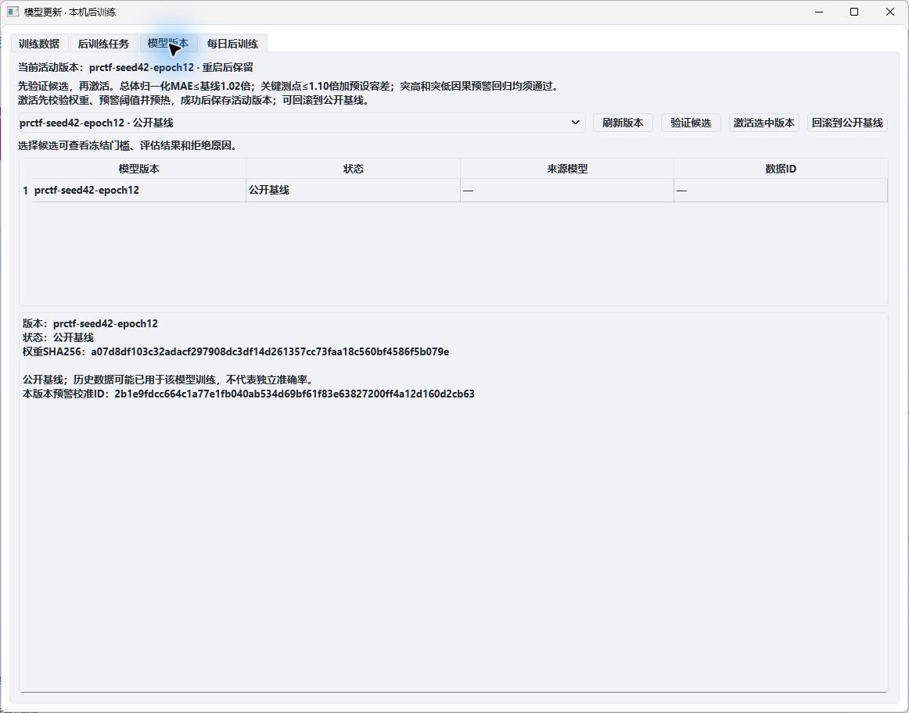

# 电解槽AI监控系统

**简体中文** · [English](README.en.md) · [预测模型：PhysicsRelationCTF](https://github.com/field-mx/PhysicsRelationCTF)

基于 **PyQt6 + FastAPI + PRCTF** 的 Windows 桌面软件，用 Excel 历史数据回放呈现电解槽监测、真实预测、残差预警及模型更新。推理、训练和每日任务均在本机 CPU 上运行，无需学校服务器。



*软件模型管理界面的实际截图，仅显示公开基线和操作入口，不包含工业实测数据及私有候选评估结果。*

## 功能

| 模块 | 功能 |
|---|---|
| Excel 回放 | 参考工作簿含61测点、1秒采样；支持播放、暂停、重置和倍速。 |
| 真实预测 | 输入过去96秒，输出未来连续96秒；56通道参与预测，其余参考测点仅观测。 |
| 残差预警 | 回放副本可注入突高/突低；连续3点残差超限触发、5点有效正常恢复；支持事件查看与CSV导出。 |
| 三维示意 | 展示电解槽结构及测点状态，未确认安装位置不虚构定位。 |
| 本机后训练 | 拖入正常Excel，校验通道和时间分区，独立进程执行真实微调，显示进度及loss。 |
| 版本管理 | 候选先验证，通过后手动激活，支持回滚至公开基线。 |
| 每日更新 | 默认关闭，Asia/Shanghai时区；仅处理合格且未处理过的新数据，重复回放不算新增；不会自动激活候选。 |

## 模型算法

算法与公开权重位于 **[field-mx/PhysicsRelationCTF](https://github.com/field-mx/PhysicsRelationCTF)**。

- 固定提交：[`9b9b19401d0e87fe8b0c21c27abe3368ecc73122`](https://github.com/field-mx/PhysicsRelationCTF/tree/9b9b19401d0e87fe8b0c21c27abe3368ecc73122)。
- 工业权重：[`weights/industrial/prctf_seed42.pt`](https://github.com/field-mx/PhysicsRelationCTF/blob/9b9b19401d0e87fe8b0c21c27abe3368ecc73122/weights/industrial/prctf_seed42.pt)。
- 输入输出：`[B,96,56] → [B,96,56]`，使用1秒采样的原始单位；标准化及反标准化由公开预测器完成。
- ChannelTokenFormer 固定版本：`b1c100effb9c27cd25de07e91de7f9005d18d5e7`，使用模型仓库的上游获取脚本下载。

黄色曲线显示最新一轮完整96步预测。绿色曲线固定记录每个观测时刻到达前的最新预测；连续每秒更新时，它对应提前1秒预测。预警比较这种因果残差，不读取人工注入标记。

## Windows 启动

需要 **64位 Python 3.11**。已拿到完整离线交付文件夹时，首次运行 `Setup.cmd`，之后双击 `StartDemo.cmd`；结束后台使用 `StopBackend.cmd`。

公开仓库包含源码和界面图，原始工业Excel、运行记录、模型下载目录、Python环境和离线依赖包不上传。从源码运行，请安装 Git 后在 PowerShell 执行：

```powershell
git clone https://github.com/field-mx/Sensor_Dashboard.git
cd Sensor_Dashboard

# 获取固定模型及其指定的上游源码。
git clone https://github.com/field-mx/PhysicsRelationCTF.git vendor/PhysicsRelationCTF
git -C vendor/PhysicsRelationCTF checkout --detach 9b9b19401d0e87fe8b0c21c27abe3368ecc73122
py -3.11 vendor/PhysicsRelationCTF/scripts/fetch_upstreams.py --ctf

py -3.11 -m venv .venv
.\.venv\Scripts\python.exe -m pip install torch==2.11.0+cpu --index-url https://download.pytorch.org/whl/cpu
.\.venv\Scripts\python.exe -m pip install -r requirements-lock.txt
.\StartDemo.cmd
```

打开软件后，选择或拖入有权使用的Excel，点击“导入数据”及“播放”。源码仓库不附私有工作簿；`Setup.cmd`检查完整交付资源，从源码启动请使用上面的安装命令。

Excel 可采用原始 SensorData 三行表头，或第一列为 `source_time`、`time`、`时间`、其后为测点ID的单行表头。须包含 [model-schema.json](configs/model-schema.json) 中全部模型通道、有限数值及严格连续的1秒时间。

## 使用流程

**导入Excel → 播放 → 96点预热后预测 → 注入突高/突低并查看预警 → 导入正常数据后训练 → 验证候选 → 激活或回滚。**

每日训练可在模型更新窗口开启并保存时间。关闭前端后，后台需保持运行。默认API为 `http://127.0.0.1:18000`，仅本机访问；配置、任务和新权重保存在 `%LOCALAPPDATA%\SensorDashboardDemo\runtime`。

## 代码与文档

| 目录 | 用途 |
|---|---|
| `sensor_demo/` | 桌面界面、回放、异步预测、预警和模型更新窗口 |
| `demo_server/` | 推理、训练进程、候选验证、版本切换和调度 |
| `demo_tools/` | 环境安装、完整性检查及离线打包 |
| `configs/` | 模型通道、基线预警校准和冻结评估配方 |
| `docs/images/` | 中英README共用的实际截图 |
| `tests/` | 开发检查；模型与数据集成检查需准备授权的本地资源 |

[操作指南](docs/操作指南.md) · [代码说明](docs/代码说明.md) · [离线Windows部署](docs/Windows本机部署.md) · [演示步骤](docs/演示步骤.md)

完整本地交付已通过45项开发检查和实际桌面验收。历史数据可能用于基线训练，残差预警不等同于确认设备故障，后训练不保证效果提升。

此前的main保留在 [`backup/main-before-ai-monitor-20261106`](https://github.com/field-mx/Sensor_Dashboard/tree/backup/main-before-ai-monitor-20261106)。模型与上游说明见[算法仓库](https://github.com/field-mx/PhysicsRelationCTF/blob/9b9b19401d0e87fe8b0c21c27abe3368ecc73122/THIRD_PARTY_NOTICES.md)，Logo来源见 [SOURCES.md](sensor_demo/assets/SOURCES.md)。
